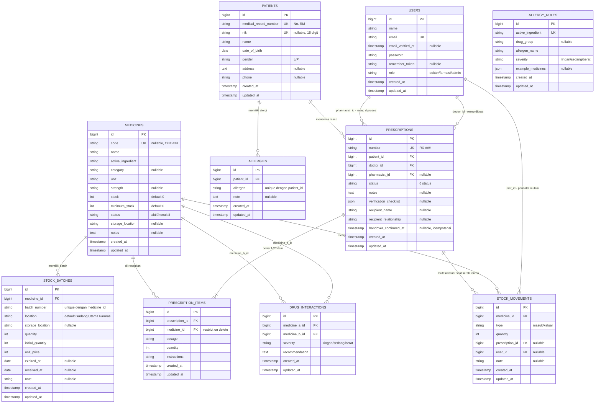
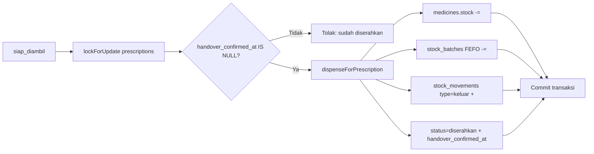

# ERD SIMPRESO

**Sistem Informasi Manajemen Preskripsi dan Stok Obat**

Dokumen ini mendeskripsikan model data SIMPRESO berdasarkan schema yang benar-benar ada di repository (file `database/migrations/*` dan `app/Models/*`), lalu memetakannya ke alur Dokter → Farmasi → Admin.

- Sumber: 15 file migration (11 migration domain + 4 migration bawaan Laravel).
- Ruang lingkup: **10 tabel domain**. Tabel teknis Laravel (`cache`, `cache_locks`, `jobs`, `job_batches`, `failed_jobs`, `sessions`, `password_reset_tokens`) sengaja tidak dimasukkan.
- Tidak ada tabel/kolom yang ditambahkan untuk keperluan ilustrasi. Jika suatu konsep belum tersedia di database, hal itu dicatat di bagian [Batasan schema](#batasan-schema--hal-yang-tidak-dikarang).

---

## 1. Diagram Entity Relationship

Relasi `ALLERGY_RULES` sengaja **tidak** digambar dengan garis FK: tabel ini tidak memiliki foreign key. Hubungannya bersifat semantik, yaitu `allergy_rules.active_ingredient` dicocokkan dengan `medicines.active_ingredient`, dan `allergy_rules.drug_group` / `allergen_name` dipakai untuk menerjemahkan `allergies.allergen` menjadi peringatan. Lihat bagian [Batasan schema](#batasan-schema--hal-yang-tidak-dikarang).

---

## 2. Daftar Relasi dan Kardinalitas

| No | Relasi | Kardinalitas | Foreign key | On delete | Keterangan |
|---|---|---|---|---|---|
| 1 | `users` → `prescriptions` | 1 : N | `prescriptions.doctor_id` | `cascade` | Satu akun dokter membuat banyak resep |
| 2 | `users` → `prescriptions` | 1 : N | `prescriptions.pharmacist_id` | `nullOnDelete` | Satu akun farmasi memproses banyak resep; nullable sebelum diproses |
| 3 | `users` → `stock_movements` | 1 : N | `stock_movements.user_id` | `nullOnDelete` | Petugas/admin yang mencatat mutasi |
| 4 | `patients` → `allergies` | 1 : N | `allergies.patient_id` | `cascade` | `UNIQUE(patient_id, allergen)`, duplikat case-insensitive dicegah di level aplikasi |
| 5 | `patients` → `prescriptions` | 1 : N | `prescriptions.patient_id` | `cascade` | Riwayat resep pasien |
| 6 | `prescriptions` → `prescription_items` | 1 : N (1–20) | `prescription_items.prescription_id` | `cascade` | Satu resep minimal satu item |
| 7 | `medicines` → `prescription_items` | 1 : N | `prescription_items.medicine_id` | `restrict` | Obat yang sudah diresepkan tidak boleh dihapus |
| 8 | `medicines` → `stock_batches` | 1 : N | `stock_batches.medicine_id` | `cascade` | `UNIQUE(medicine_id, batch_number)` |
| 9 | `medicines` → `stock_movements` | 1 : N | `stock_movements.medicine_id` | `cascade` | Riwayat stok masuk/keluar per obat |
| 10 | `prescriptions` → `stock_movements` | 1 : N (opsional) | `stock_movements.prescription_id` | `nullOnDelete` | Diisi hanya untuk mutasi `keluar` hasil serah terima |
| 11 | `medicines` ↔ `drug_interactions` | 1 : N | `drug_interactions.medicine_a_id` | `cascade` | Sisi A aturan interaksi |
| 12 | `medicines` ↔ `drug_interactions` | 1 : N | `drug_interactions.medicine_b_id` | `cascade` | Sisi B aturan interaksi |

Relasi 11 + 12 membentuk relasi **N : M antar obat dengan entitas asosiasi** `drug_interactions`, dengan atribut tambahan `severity` dan `recommendation`. Pasangan dibatasi `UNIQUE(medicine_a_id, medicine_b_id)`.

---

## 3. Kamus Data per Tabel

Semua tabel memiliki `id` (PK, `bigint`, auto increment) serta `created_at` dan `updated_at` (`timestamp`, dikelola Laravel), kecuali dinyatakan lain.

### 3.1 `users` — Akun & peran

| Kolom | Tipe | Constraint / Default | Keterangan |
|---|---|---|---|
| `name` | string | wajib | Nama petugas, ditampilkan di header dashboard |
| `email` | string | `UNIQUE`, wajib | Satu pintu login `/login` |
| `email_verified_at` | timestamp | nullable | Laravel default |
| `password` | string | wajib, hashed | — |
| `remember_token` | string | nullable | Laravel default |
| `role` | string | `default 'dokter'`, `INDEX` | Enum PHP: `dokter`, `farmasi`, `admin`. Ditentukan admin, bukan user |

Relasi Eloquent: `prescriptionsAsDoctor()`, `prescriptionsAsPharmacist()`, `stockMovements()`. Tidak ada registrasi publik.

### 3.2 `patients` — Data pasien

| Kolom | Tipe | Constraint / Default | Keterangan |
|---|---|---|---|
| `medical_record_number` | string | `UNIQUE`, wajib | No. Rekam Medis; kunci idempotensi impor CSV |
| `nik` | string(16) | `UNIQUE`, nullable | NIK; dipakai pencarian server-side |
| `name` | string | wajib | Dipakai pencarian |
| `date_of_birth` | date | wajib | Bisa dihitung dari kolom Usia saat impor |
| `gender` | string(1) | wajib | Enum PHP: `L`, `P` |
| `address` | text | nullable | — |
| `phone` | string | nullable | — |

Relasi Eloquent: `allergies()`, `prescriptions()`.

### 3.3 `medicines` — Formularium & stok

| Kolom | Tipe | Constraint / Default | Keterangan |
|---|---|---|---|
| `code` | string | `UNIQUE`, nullable | Kode obat (`OBT-###` otomatis saat impor jika kosong) |
| `name` | string | wajib | Nama obat |
| `active_ingredient` | string | wajib | Bahan aktif; dipakai pencocokan alergi |
| `category` | string | nullable | Filter kategori formularium dokter |
| `unit` | string | wajib | Satuan (tablet, kapsul, mL, dll.) |
| `strength` | string | nullable | Kekuatan dosis, mis. `500 mg` |
| `stock` | integer | `default 0` | Stok ringkas; **hanya berkurang saat serah terima** |
| `minimum_stock` | integer | `default 0` | Ambang stok kritis (`stock <= minimum_stock`) |
| `status` | string | `default 'aktif'`, `INDEX` | Enum PHP: `aktif`, `nonaktif`. Hanya `aktif` muncul di formularium |
| `storage_location` | string | nullable | Lokasi penyimpanan |
| `notes` | text | nullable | Catatan obat |

Relasi Eloquent: `prescriptionItems()`, `stockMovements()`, `batches()`. Scope `active()`, method `isLowStock()`.

### 3.4 `allergies` — Alergi pasien

| Kolom | Tipe | Constraint / Default | Keterangan |
|---|---|---|---|
| `patient_id` | bigint | FK → `patients.id`, `cascade` | Pemilik alergi |
| `allergen` | string | `UNIQUE(patient_id, allergen)` | Nama alergen; duplikat case-insensitive dicegah di aplikasi |
| `note` | text | nullable | Catatan tambahan |

Dipakai dokter sebagai peringatan **non-blocking** saat memilih obat.

### 3.5 `allergy_rules` — Aturan alergi (master data admin)

| Kolom | Tipe | Constraint / Default | Keterangan |
|---|---|---|---|
| `active_ingredient` | string | `UNIQUE`, wajib | Bahan aktif yang memicu alergi |
| `drug_group` | string | nullable | Kelompok obat terkait |
| `allergen_name` | string | wajib | Nama alergen yang ditampilkan |
| `severity` | string | `default 'sedang'` | Enum PHP: `ringan`, `sedang`, `berat` |
| `example_medicines` | json | nullable | Daftar contoh nama obat (disimpan sebagai JSON) |

Tidak memiliki FK. Pengecekan dilakukan dengan mencocokkan `active_ingredient` obat terhadap aturan ini dan/atau daftar `allergies` pasien.

### 3.6 `drug_interactions` — Aturan interaksi obat (master data admin)

| Kolom | Tipe | Constraint / Default | Keterangan |
|---|---|---|---|
| `medicine_a_id` | bigint | FK → `medicines.id`, `cascade` | Obat A |
| `medicine_b_id` | bigint | FK → `medicines.id`, `cascade` | Obat B |
| `severity` | string | `default 'ringan'` | Enum PHP: `ringan`, `sedang`, `berat` |
| `recommendation` | text | wajib | Saran untuk petugas/dokter |

`UNIQUE(medicine_a_id, medicine_b_id)`. Dipakai untuk mencocokkan semua pasangan item dalam satu resep.

### 3.7 `prescriptions` — Resep elektronik (intisari alur)

| Kolom | Tipe | Constraint / Default | Keterangan |
|---|---|---|---|
| `number` | string | `UNIQUE` | Nomor resep `RX-###`, digenerate `PrescriptionService::nextNumber()` |
| `patient_id` | bigint | FK → `patients.id`, `cascade` | Pasien penerima resep |
| `doctor_id` | bigint | FK → `users.id`, `cascade` | Dokter pembuat resep |
| `pharmacist_id` | bigint | FK → `users.id`, nullable, `nullOnDelete` | Diisi saat farmasi memproses resep |
| `status` | string | `default 'menunggu'`, `INDEX` | Enum PHP: `menunggu`, `diterima`, `disiapkan`, `siap_diambil`, `diserahkan`, `dibatalkan` |
| `notes` | text | nullable | Catatan dokter / alasan pembatalan |
| `verification_checklist` | json | nullable | Checklist verifikasi farmasi (`array` cast); kunci `handover_confirmed` ditambahkan saat serah terima |
| `recipient_name` | string | nullable | Nama penerima obat saat serah terima |
| `recipient_relationship` | string | nullable | Hubungan penerima dengan pasien |
| `handover_confirmed_at` | timestamp | nullable | Penanda idempotensi; resep dengan nilai ini **tidak boleh diproses ulang** |

Transisi status diatur di `PharmacyQueueService::TRANSITIONS` (hanya farmasi, tidak boleh melompat, terkunci setelah `diserahkan`).

### 3.8 `prescription_items` — Item obat dalam resep

| Kolom | Tipe | Constraint / Default | Keterangan |
|---|---|---|---|
| `prescription_id` | bigint | FK → `prescriptions.id`, `cascade` | Resep induk |
| `medicine_id` | bigint | FK → `medicines.id`, `restrict` | Obat dari formularium aktif |
| `dosage` | string | wajib | Dosis, mis. `1 tablet` |
| `quantity` | integer | wajib | Jumlah yang diminta/diserahkan; jadi dasar pengurangan stok |
| `instructions` | string | wajib | Aturan pakai / signa |

Satu resep memuat 1–20 item; obat tidak boleh duplikat dalam satu resep (divalidasi di `StoreBulkPrescriptionRequest`).

### 3.9 `stock_batches` — Batch stok (FEFO)

| Kolom | Tipe | Constraint / Default | Keterangan |
|---|---|---|---|
| `medicine_id` | bigint | FK → `medicines.id`, `cascade` | Obat pemilik batch |
| `batch_number` | string | `UNIQUE(medicine_id, batch_number)` | Nomor batch, mis. `BTH-INIT-0001` |
| `location` | string | `default 'Gudang Utama Farmasi'` | Lokasi fisik batch |
| `storage_location` | string | nullable | Lokasi penyimpanan detail |
| `quantity` | integer | `default 0` | Sisa batch; dikurangi FEFO saat serah terima |
| `initial_quantity` | integer | `default 0` | Jumlah awal batch |
| `unit_price` | integer | `default 0` | Harga satuan (nilai inventaris) |
| `expired_at` | date | nullable, `INDEX` | Tanggal kedaluwarsa; urutan FEFO |
| `received_at` | date | nullable, `INDEX` | Tanggal penerimaan batch |
| `note` | string | nullable | Catatan batch |

`StockService::createInitialBatch()` dipakai saat obat baru ditambahkan; `addBatch()` untuk penerimaan stok; `syncBatches()` untuk penyesuaian manual.

### 3.10 `stock_movements` — Riwayat mutasi stok

| Kolom | Tipe | Constraint / Default | Keterangan |
|---|---|---|---|
| `medicine_id` | bigint | FK → `medicines.id`, `cascade` | Obat yang bermutasi |
| `type` | string | `INDEX` | Enum PHP: `masuk`, `keluar` |
| `quantity` | integer | wajib | Jumlah mutasi (selalu positif; arah ditentukan `type`) |
| `prescription_id` | bigint | FK → `prescriptions.id`, nullable, `nullOnDelete` | Diisi untuk mutasi `keluar` dari serah terima |
| `user_id` | bigint | FK → `users.id`, nullable, `nullOnDelete` | Petugas yang mencatat |
| `note` | string | nullable | Keterangan, mis. `Serah terima resep RX-001` |

Mutasi `keluar` adalah sumber data laporan "Top 10 obat paling sering keluar" dan tren penggunaan bulanan.

---

## 4. Enum yang Dipakai

| Enum PHP | File | Nilai |
|---|---|---|
| `Role` | `app/Enums/Role.php` | `dokter`, `farmasi`, `admin` |
| `Gender` | `app/Enums/Gender.php` | `L`, `P` |
| `MedicineStatus` | `app/Enums/MedicineStatus.php` | `aktif`, `nonaktif` |
| `PrescriptionStatus` | `app/Enums/PrescriptionStatus.php` | `menunggu`, `diterima`, `disiapkan`, `siap_diambil`, `diserahkan`, `dibatalkan` |
| `StockMovementType` | `app/Enums/StockMovementType.php` | `masuk`, `keluar` |
| `InteractionSeverity` | `app/Enums/InteractionSeverity.php` | `ringan`, `sedang`, `berat` |

Catatan: `allergy_rules.severity` juga memakai `InteractionSeverity` (via Eloquent cast), sehingga nilainya identik.

---

## 5. Pemetaan Alur SIMPRESO ke ERD

### 5.1 Fase Dokter — pembuatan resep

| Langkah alur | Entitas | Kolom / relasi yang dipakai |
|---|---|---|
| Login sebagai dokter | `users` | `role = 'dokter'` → redirect `dokter.daftar-pasien` |
| Lihat daftar/detail pasien | `patients` | `created_at` (pasien hari ini), `medical_record_number`, `nik` |
| Lihat & kelola alergi | `allergies`, `allergy_rules` | `allergies.allergen`; aturan alergi dipakai untuk menerjemahkan ke bahan aktif |
| Pilih obat dari formularium | `medicines` | `status = 'aktif'`, `stock`, `category`, `active_ingredient` |
| Cek alergi (peringatan merah, non-blocking) | `allergies` + `medicines.active_ingredient` + `allergy_rules` | Peringatan tidak menghalangi penyimpanan |
| Cek interaksi (peringatan oranye, non-blocking) | `drug_interactions` + `prescription_items` | Semua pasangan obat dalam resep dicek |
| Simpan resep | `prescriptions` + `prescription_items` | `number = RX-###`, `status = 'menunggu'`, `doctor_id` |
| **Yang TIDAK terjadi** | `medicines.stock`, `stock_batches`, `stock_movements` | **Stok belum dikurangi** pada tahap ini |

### 5.2 Fase Farmasi — verifikasi sampai serah terima

| Langkah alur | Entitas | Perubahan data |
|---|---|---|
| Dashboard antrean | `prescriptions` + `patients` | Filter 4 status aktif: `menunggu`, `diterima`, `disiapkan`, `siap_diambil` |
| Checklist verifikasi & terima | `prescriptions` | `pharmacist_id` diisi, `verification_checklist` disimpan, status → `diterima` |
| Siapkan obat | `prescriptions` | status → `disiapkan` |
| Siap di loket | `prescriptions` | status → `siap_diambil` |
| Konfirmasi serah terima | `prescriptions` | `recipient_name`, `recipient_relationship`, `handover_confirmed_at`, `checklist.handover_confirmed`, status → `diserahkan` — **dalam satu DB transaction + `lockForUpdate()`** |
| Efek: potong stok | `medicines.stock`, `stock_batches.quantity` | `quantity` tiap item dikurangi; batch dikurangi urutan FEFO (expired terdekat dulu) |
| Efek: catat mutasi | `stock_movements` | `type = 'keluar'`, `prescription_id`, `user_id`, `note = 'Serah terima resep RX-###'` |
| Idempotensi | `prescriptions.handover_confirmed_at` | Jika sudah tidak null (atau status sudah `diserahkan`) → ditolak dengan pesan jelas, tidak ada perubahan stok/mutasi |
| Pembatalan | `prescriptions.status` | Hanya dari status sebelum `diserahkan`; alasan masuk `notes` / `verification_checklist.cancel_reason` |

Diagram alur data serah terima (kritis):

### 5.3 Fase Admin — master data & pelaporan

| Kegiatan | Entitas | Kolom yang dikelola |
|---|---|---|
| CRUD obat | `medicines` | `code`, `name`, `active_ingredient`, `category`, `unit`, `strength`, `status` |
| Atur stok & stok minimum | `medicines`, `stock_batches` | `stock`, `minimum_stock`, batch + `stock_movements.type = 'masuk'` |
| Kelola pasien | `patients` | `medical_record_number`, `nik`, demografi |
| Buat akun & atur peran | `users` | `name`, `email`, `password`, `role` (tanpa registrasi publik) |
| Aturan alergi | `allergy_rules` | `active_ingredient`, `allergen_name`, `severity`, `example_medicines` |
| Aturan interaksi | `drug_interactions` | pasangan obat, `severity`, `recommendation` |
| Peringatan stok minimum | `medicines` | `stock <= minimum_stock` |
| Riwayat stok | `stock_movements` | `type`, `quantity`, `created_at` |
| Top 10 & tren bulanan | `stock_movements` + `medicines` | Agregasi `type = 'keluar'` per obat per bulan |

---

## 6. Batasan Schema / Hal yang Tidak Dikarang

Konsep berikut **ada di mock/dokumen alur tetapi tidak memiliki tabel di database saat ini**, sehingga tidak digambar sebagai entitas:

1. **Kunjungan / Poli / Loket / Prioritas / Shift / BPJS** — tidak ada tabel kunjungan. "Pasien hari ini" memakai proxy `patients.created_at`; nomor antrean dihitung dari urutan `created_at, id`.
2. **Riwayat transisi status farmasi** — tidak ada tabel status history. Timeline hanya menampilkan `prescriptions.created_at` dan `handover_confirmed_at`; waktu transisi `diterima`/`disiapkan`/`siap_diambil` tidak dikarang.
3. **Draft resep** — tidak ada status `draft`; tombol "Simpan sebagai Draft" masih placeholder (lihat `AGENTS.md`).
4. **Idempotency key terpisah** — idempotensi serah terima saat ini dijaga oleh `handover_confirmed_at` + row lock, bukan tabel/key khusus.
5. **`allergy_rules` tanpa FK** — relasi ke `medicines` dan `allergies` bersifat logis (berdasarkan `active_ingredient` / `allergen_name`), bukan foreign key. Ini disengaja agar aturan bisa dibuat sebelum obat atau pasien tertentu ada.
6. **Checklist tersimpan sebagai JSON** — `verification_checklist` bukan tabel tersendiri; kuncinya ditentukan di service (`handover_confirmed`, `cancel_reason`, dan kunci checklist verifikasi dari request).
7. **Stok ringkas vs batch** — `medicines.stock` adalah ringkasan; `stock_batches.quantity` adalah rincian FEFO. Keduanya dikurangi bersamaan saat serah terima; penyesuaian manual lewat `StockService::syncBatches()`.

---

## 7. Ringkasan Aturan Integritas

- Satu pasien memiliki banyak resep dan banyak alergi; alergi tidak duplikat per pasien.
- Satu resep memiliki minimal satu item; item obat tidak bisa dihapus dari master saat masih dipakai (`restrict`).
- Satu obat memiliki banyak batch dan banyak mutasi stok; nomor batch unik per obat.
- Status resep hanya bergerak `menunggu → diterima → disiapkan → siap_diambil → diserahkan`, atau `dibatalkan` dari status sebelum `diserahkan`.
- Stok tidak pernah negatif; pengurangan stok **hanya** terjadi di transaksi serah terima.
- Resep yang `handover_confirmed_at`-nya terisi bersifat final dan tidak bisa diproses ulang.
